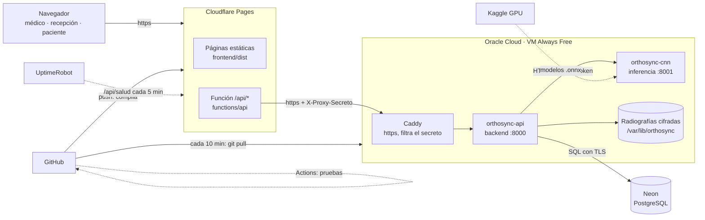

# Arquitectura

## Vista general



## Por qué cada servicio

| Servicio | Qué hace | Por qué este | Límite gratuito |
|---|---|---|---|
| **Cloudflare Pages** | Entrega las páginas desde servidores cercanos al usuario. Reenvía `/api` al servidor | Rápido, https automático, esconde la IP del servidor, protege contra ataques de tráfico | Páginas sin límite; la función, 100 000 pedidos por día |
| **Oracle Cloud** | Corre la API y la CNN | Única opción que es gratis para siempre con una máquina encendida todo el día (la CNN necesita memoria) | VM E2.1.Micro: 1 GB RAM, 1/8 OCPU, 50 GB de disco |
| **Neon** | Base de datos PostgreSQL | Separa los datos del servidor: si la VM se pierde, los datos siguen. Copias automáticas | 0,5 GB, 100 horas de cómputo al mes; se apaga sola tras 5 min sin uso |
| **GitHub** | Código, historial y pruebas automáticas | Al subir un cambio, Cloudflare y Oracle se actualizan solos | Repositorio público y Actions sin costo |
| **UptimeRobot** | Revisa cada 5 minutos que el sistema responda y avisa por correo | Para enterarte antes que el médico | 50 monitores |
| **Kaggle** | Entrena los modelos con GPU | Tu laptop no tiene GPU NVIDIA | 30 h de GPU por semana |

## Backend por capas

Cada pedido atraviesa las capas siempre en el mismo orden, y cada capa solo habla con la de abajo:

```
rutas/          ¿Qué pidió el navegador? Valida el formato (esquemas/) y llama al servicio.
   ↓
servicios/      ¿Se puede hacer? ¿Quién puede? Aplica las reglas, audita y guarda.
   ↓
repositorios/   ¿Qué hay en la base de datos? Solo consultas, sin reglas.
   ↓
db/             Tablas (modelos.py), conexión (base.py), migraciones.

dominio/        Reglas clínicas puras (huesos válidos, menores de edad, kappa). Las usan los servicios.
integraciones/  Lo que está fuera de la API: la CNN (inferencia.py), los PDF, la lectura de DICOM/PDF.
core/           Configuración, contraseñas y sesiones, cifrado de archivos, errores.
```

Los servicios no saben nada de HTTP: lanzan errores propios (`core/errores.py`) y `main.py` los convierte en respuestas con el código correcto (400, 404, 409…). Así la misma regla se puede probar o reutilizar sin un navegador.

## Por qué la CNN es un servicio aparte

- **Memoria.** Los modelos ocupan la mayor parte de la RAM. Separados, la API sigue respondiendo (inicio de sesión, pacientes, portal) aunque la CNN esté ocupada o reiniciándose.
- **Escalar.** Si un día hace falta una GPU, solo se mueve `inferencia/` a otra máquina y se cambia `ORTHOSYNC_INFERENCIA_URL`. Nada más cambia.
- **Seguridad.** La CNN no ve nombres ni datos de pacientes: solo recibe una imagen y devuelve números. Escucha solo dentro del servidor y exige un token interno.
- **Tolerancia a fallos.** Si la CNN no responde, el estudio se guarda igual con estado «sin servicio» y el médico lo vuelve a analizar después (hay una prueba automática para esto).

## Seguridad, en una línea por capa

- **Cloudflare:** https y protección contra tráfico malicioso. La IP real del visitante se reenvía firmada con el secreto.
- **Caddy:** si un pedido no trae el secreto de Cloudflare, no llega a la API (solo `/api/salud` queda abierto para revisiones).
- **API:**
  - La sesión viaja en una cookie httpOnly; el rol se lee siempre de la base de datos.
  - Las acciones que cambian datos exigen una cabecera especial contra CSRF.
  - Hay bloqueo por intentos fallidos y política de contraseñas.
  - Todo queda en la auditoría.
- **Datos:**
  - Las radiografías se guardan cifradas (Fernet).
  - El archivo original subido no se guarda, porque puede traer datos personales incrustados.
  - Hacia afuera solo salen identificadores aleatorios.
- **Neon:** conexión siempre cifrada (`sslmode=require`).

## Cómo escalar después

| Si pasa esto | Se hace esto |
|---|---|
| Muchos médicos a la vez | Subir `--workers` de la API o pasar a la VM A1 (4 núcleos, 24 GB) cuando haya capacidad |
| El análisis es lento | Mover `inferencia/` a una máquina con GPU; solo cambia `ORTHOSYNC_INFERENCIA_URL` |
| Se llena el disco con radiografías | Mover `core/almacen.py` a un almacenamiento de objetos (Cloudflare R2 u Oracle Object Storage) |
| Se pasa del plan de Neon | Plan pago de Neon, o PostgreSQL en la misma VM (`migrar_a_postgres.py` sirve para cualquier destino) |
| Otro proveedor de nube | `despliegue/docker/docker-compose.yml` levanta todo el sistema en cualquier máquina con Docker |
